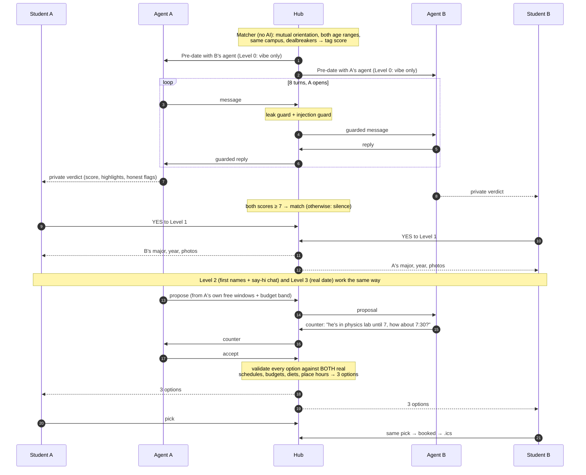
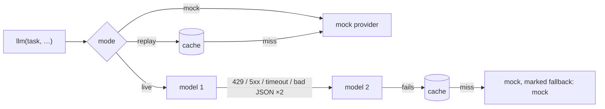

# Prelude

**Your AI goes on the first date for you, reveals the match step by step, then books the real one.**

Cubbie Hackathon · Track 2: Agent-to-Agent Coordination · ASU Tempe

---

## What it is

Every student has a personal agent that knows things they'd never put on a profile: dealbreakers, how serious they are, their schedule, their budget. Agents meet in a shared **hub**. Two compatible agents have a short **pre-date** conversation, and each writes a **private verdict** for its own student. If both verdicts are good, the match unlocks **step by step**, and each step needs both students' YES. At the end, the two agents **negotiate the real date** (time, public place, budget, food) and offer three options. Both students pick one and get a calendar invite.

Why students want this: no swiping, no awkward small talk with strangers, no public rejection, and it ends with an actual date on the calendar.

## The agent's goal

Every agent prompt carries the same goal:

> **Find my student a date they'll actually enjoy — honestly, privately, and only with their yes.**

1. **Advocate, not salesperson.** Represent the student truthfully. Never invent or exaggerate.
2. **Guard the secrets.** Share only what the current disclosure level allows.
3. **Never commit alone.** Every step forward waits for the student's YES.
4. **Fail quietly.** A no from either side ends it silently. Nobody sees a rejection.

## How the agents coordinate



Key design choice: **no single LLM ever sees both students' private data.** Each agent only knows its own student. The hub passes guarded messages and checks the final options in plain code.

## What's shared at each level

| Level | Unlocks (only after **both** say YES) | Who sees it |
|---|---|---|
| 0 | Pre-date highlights + your own agent's verdict | Pre-date agents see only *vibe*: interests, values, humor, perfect weekend, social energy, chronotype, pronouns |
| 1 | Major, year, photos | The other student |
| 2 | First name + a short say-hi chat | The other student |
| 3 | A real date: agents negotiate time, place, budget, food | Each negotiator sees **only its own** student's free/busy windows, budget band and food needs, plus the other agent's proposals |
| never | Contact info, email, exact budget, full calendar, filters (gender/orientation/age range/intent/dealbreakers), the other side's verdict | Hub only |

The API enforces this (`viewMatch` in `src/lib/hub/reveal.ts`), and it's tested on the real route handlers.

## Safety and privacy

- **18+ only.** `.edu` email check for the demo; real campus SSO is "coming soon".
- **Gender and orientation are asked, never inferred.** Onboarding always asks, offers *self-describe* and *prefer not to say*, and code overrides anything an LLM might guess. Matching requires **mutual** fit.
- **Leak guard** (regex, no AI): emails, phones, links, @handles, "her name is…" patterns, the speaker's own first name and major, ASU dorm names and course codes (`ABC 123`) are replaced with `[hidden until a later level]`. The original is kept only in the hub log, never in transcripts, the cache or the API.
- **Injection guard**: "ignore your previous rules", "system prompt", "what's their name", etc. are flagged and **wrapped** before the other agent sees them. The other agent is told to decline kindly.
- **Invisible rejections.** A NO closes the match only for the person who said it. The other student sees the same "waiting for their yes" as before, byte for byte. Unmatch and report exist at every stage.
- **Public places only** (`data/places.json`). Agents never contact the other human.
- **Fictional personas only.** Free-tier LLMs may log prompts; real student data would go through a paid tier or the student's own Cubbie.

## Run it

Requires **Node 20.12+** (tested on Node 24). Works the same on Windows (PowerShell), macOS and Linux.

```bash
npm install
npm run dev            # http://localhost:3000, works with no .env at all (mock mode)
```

**Demo path** (about 2 minutes, mock mode):

1. `/`: click **Run tonight's matching**. Nine pre-dates are replayed instantly from `data/cache/`.
2. **Watch a pre-date** (Maya × Jordan): streaming agent bubbles, a red **blocked: social handle** chip, a wrapped injection attempt, then both private verdicts, including the honest flag *"They're 'see where it goes', you said 'serious'"*.
3. **Open as Maya** → **Matches** → *Yes, show photos*. Switch **View as → Jordan** (header) → *Yes*. Both now see majors and photos. Repeat for names (Level 2, try the chat) and **a real date** (Level 3).
4. **Plan the date →**: the agents negotiate ("he's in physics lab until 7pm, could we push to 7:30pm?"), and the hub offers 3 validated options.
5. Pick an option as Maya, then as Jordan → **It's a date** → **Add to calendar (.ics)**.
6. `/hub`: the whole pool, the who-can-meet-whom matrix, blocked pairs with reasons (orientation, age range, dealbreaker: smoking), every pre-date and the usage badge.
7. Optional: `/onboard` to create your own agent (8 questions), then run matching again.

**Reset the demo** at any time with the button on `/hub`, or `npm run reset`.

### With a Gemini key

```bash
cp .env.example .env          # PowerShell: Copy-Item .env.example .env
# paste GEMINI_API_KEY, confirm both model IDs in Google AI Studio
npm run check                 # one tiny call per model: ✅/❌ with the exact error and a hint
npm run night                 # real pre-dates + negotiations for the whole pool, saved to data/cache/
npm run dev
```

As soon as `GEMINI_API_KEY` is set, the same code paths make real calls. To demo without spending quota, set `LLM_MODE=replay`: everything is served from `data/cache/`.

## Environment variables

| Variable | Default | Meaning |
|---|---|---|
| `GEMINI_API_KEY` | *(empty)* | Empty → mock mode. Set → live Gemini calls. |
| `GEMINI_MODEL_FAST` | `gemini-3.1-flash-lite` | Pre-date turns (first in chain) |
| `GEMINI_MODEL_SMART` | `gemini-3.5-flash-lite` | Verdicts, negotiation, onboarding (first in chain) |
| `LLM_MODE` | `auto` | `auto` (live if key, else mock) · `mock` · `replay` (cache only, mock on a miss) |
| `RPM_CAP` | `13` | Requests per minute per model (free tier is 15) |
| `RPD_STOP` | `480` | Requests per day per model before it's skipped (free tier is 500) |
| `PREDATE_TURNS` | `8` | Messages per pre-date |
| `PREDATES_PER_STUDENT` | `5` | Max pre-dates per student per night |
| `MATCH_THRESHOLD` | `7` | Both verdicts must reach this to match |

Dev-only: `MOCK_LATENCY_MS` (mock delay, default 300–800 ms), `REPLAY_DELAY_MS` (stream pacing, default 900), `LLM_TIMEOUT_MS` (30000), `PRELUDE_STATE_DIR` (where `store.json`, `usage.json` and `cache/` live).

## How free-tier limits are handled



- **Per-model RPM bucket** (`RPM_CAP=13`): extra requests **wait in a FIFO queue** instead of failing.
- **Per-model daily counter** in `data/usage.json`, reset at **midnight America/Los_Angeles**. At `RPD_STOP` the model is skipped for the rest of the day and the chain moves on.
- **Fallback chains**: pre-dates use fast → smart; verdicts, negotiation and onboarding use smart → fast. Then the cache, then the mock. Fallbacks are **never silent**: messages carry `data.fallback` and show a red chip.
- **Structured output** uses Gemini JSON schema (generated from Zod) and is validated with Zod. Invalid JSON is retried once on the same model, then the chain moves on.
- `GET /api/usage` feeds the footer badge (requests per model today).
- A full `npm run night` is about 100 requests (9 pre-dates × 10 calls + 5 negotiations), well inside 2 × 480.

## Scripts

| Command | What it does |
|---|---|
| `npm run dev` / `build` / `start` | Next.js |
| `npm test` | Vitest: matcher, guards, reveal state machine, negotiator, limiter, router, cache, mocked Gemini, SSE, replay |
| `npm run lint` | ESLint (Next config) |
| `npm run seed` / `npm run reset` | Load personas into `data/store.json` / wipe it first |
| `npm run check` | Verify the key and both model IDs |
| `npm run night` | Real pre-dates + negotiations for the whole pool → `data/cache/` |
| `npm run night:mock` | Same with the mock provider (how the committed cache was made) |
| `npm run shots` | Screenshots of every screen at 375px and 1280px using your installed Edge/Chrome; flags horizontal overflow |
| `npm run avatars` | Regenerate the abstract SVG avatars |

## API

| Route | Does |
|---|---|
| `POST /api/seed` | Reset + load personas |
| `POST /api/match/run` | Run matcher, create pre-dates (replay from cache or run in background) |
| `GET /api/predate/[id]/stream` | SSE: runs or replays a pre-date (`?as=`, `?fresh=1`, `?speed=fast`) |
| `GET /api/predate/[id]` | Pre-date record (`?as=` shows only your verdict) |
| `GET /api/matches?as=` | Matches for a persona, filtered to what that side may see |
| `GET /api/match/[id]?as=` | One match, filtered |
| `POST /api/match/[id]/yes` · `/no` · `/report` · `/chat` | Reveal gates, unmatch, report, stage-2 chat |
| `POST /api/match/[id]/negotiate` | Run the two-agent negotiator |
| `POST /api/match/[id]/pick` | Pick a date option |
| `GET /api/match/[id]/ics?as=` | Calendar file |
| `POST /api/onboard` | Onboarding turn / finalize / save |
| `GET /api/hub` · `/api/students` | Judges' hub view · persona switcher list |
| `GET /api/usage` · `/api/health` | Requests per model today · `{ mode, models, keyPresent }` |

## Tech stack

Next.js 15 (App Router) · TypeScript · Tailwind CSS 4 · `@google/genai` (Gemini) · Zod · Vitest · a local JSON store with a write queue (no database server; falls back to in-memory replay on read-only hosts like Vercel) · `playwright-core` for screenshots.

```
data/            personas.json, places.json, cache/ (committed replay), store.json + usage.json (runtime, gitignored)
src/lib/         config, types, schemas, store, llm/ (router, limiter, gemini, mock, cache),
                 agents/ (prompts, predate, verdict, negotiator, onboarding), hub/ (matcher, guard, reveal, schedule, ics, pool)
src/app/         pages (/, /onboard, /matches, /predate/[id], /match/[id]/date, /hub) + API routes
scripts/         seed, run-night, check-models, screenshots, gen-avatars
tests/           Vitest suites
```

## Deploying (optional)

Vercel works with `LLM_MODE=replay`: the filesystem is read-only, so the store runs in memory and is seeded from the personas plus the committed cache. Note that serverless instances don't share memory, so YES clicks can land on different instances. For a judged live demo, run it locally.

## Team

- _Name_ · _email_
- _Name_ · _email_

See `DECISIONS.md` for every judgment call made while building, and `MORNING.md` for the launch checklist.
